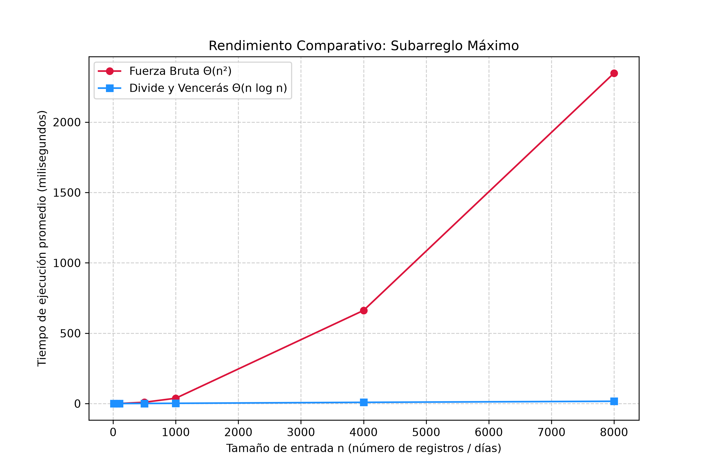

# Laboratorio Evaluativo 02: Dividir y Vencer

- **Estudiante:** Leonel Antonio Martínez Silgado
- **Curso:** Análisis de Algoritmos

---

## Instrucciones de Reproducción

Para verificar y reproducir los experimentos en el entorno de desarrollo local:
1. Abra la terminal en la raíz del repositorio y active el entorno virtual:
   * En Windows: `venv\Scripts\activate`
   * En macOS / Linux: `source venv/bin/activate`
2. Instale o verifique las dependencias necesarias: `pip install -r requirements.txt`
3. Ejecute el script de pruebas unitarias: `python pruebas.py`
4. Ejecute el script de medición y generación de la gráfica: `python medicion.py`

---

## Parte 1 — Implementación y Verificación

Los códigos fuente correspondientes a la implementación de los algoritmos y las pruebas unitarias se encuentran en los siguientes enlaces del repositorio:
* [Enlace a subarreglo.py](./subarreglo.py)
* [Enlace a pruebas.py](./pruebas.py)

**Verificación:**  
La correctitud de las funciones se validó mediante aserciones (`assert`) en el archivo `pruebas.py`, cubriendo exhaustivamente los siguientes escenarios:
* La serie de ocho días de la cooperativa (variaciones `-3, 5, -2, 8, -6, 3, 9, -4`), comprobando que la suma óptima sea `17`.
* Un caso con un arreglo unitario de un solo elemento.
* Arreglos con todos sus valores negativos.
* Arreglos con todos sus valores positivos.
* Un caso donde el tramo de mayor suma cruza explícitamente por el punto medio.
* 20 listas aleatorias de tamaños variables, comparando que ambas funciones devuelvan exactamente el mismo resultado de suma máxima.

---

## Parte 2 — Medición y Gráfica

El código del experimento de rendimiento se encuentra en el siguiente enlace:
* [Enlace a medicion.py](./medicion.py)

**Notas sobre la medición:**  El tiempo de ejecución se midió cronometrando únicamente la llamada a las funciones mediante `time.perf_counter()`, aislando por completo la generación de los datos. Para mitigar el ruido del sistema operativo, cada tamaño de entrada (n) se ejecutó promediando 5 repeticiones consecutivas. Se utilizó una semilla fija (`42`) para garantizar la total reproducibilidad de los datos de entrada, asegurando que ambos algoritmos evaluaran exactamente la misma secuencia numérica en cada tamaño.

---

## Parte 3 — Análisis de Resultados

### 1. Recurrencia
La función `subarreglo_maximo` divide el problema en dos subproblemas de tamaño n/2, lo que genera el término 2T(n/2). El proceso de combinación se realiza a través de la función `suma_cruzada`, la cual ejecuta dos barridos lineales independientes desde el punto medio hacia los extremos, tomando un tiempo lineal Θ(n). Por lo tanto, la ecuación de recurrencia es:
T(n) = 2T(n/2) + Θ(n)
Aplicando el Caso 2 del Método Maestro (a = 2, b = 2, f(n) = Θ(n) = Θ(n^(log_b a))), la solución analítica es **Θ(n log n)**.  
La fuerza bruta implementa dos ciclos anidados que acumulan la suma de forma interna sin recalcular desde cero, recorriendo los pares posibles n(n-1)/2 veces, lo que resulta en una complejidad temporal de **Θ(n²)**.

### 2. Lo medido contra lo esperado
A partir de la gráfica generada, observamos el comportamiento al duplicar el tamaño de entrada de n = 4000 a n = 8000:
- **Fuerza Bruta (Θ(n²)):** El tiempo pasa de aproximadamente 630 ms en n = 4000 a unos 2170 ms en n = 8000. Al calcular el factor de crecimiento, el tiempo se multiplica por un factor cercano a 3.44 (próximo al factor teórico de 4 esperado al duplicar en una curva cuadrática debido a pequeñas variaciones de carga en el sistema operativo).
- **Divide y Vencerás (Θ(n log n)):** El tiempo pasa de fracciones muy pequeñas de milisegundos a mantenerse sumamente plano y eficiente (por debajo de 20 ms en esos mismos puntos), reflejando un crecimiento logarítmico-lineal casi imperceptible a escala macro frente a la fuerza bruta.

### 3. Tamaños pequeños
El enfoque de Divide y Vencerás muestra una ventaja competitiva desde tamaños muy tempranos (a partir de n = 50). No se observa un punto de retraso o sobrecoste significativo por la recursión en Python dentro de este rango, ya que el costo constante de las llamadas apiladas es mínimo frente al rápido crecimiento de las iteraciones de la fuerza bruta.

### 4. ¿Cuándo conviene dividir?
Para un problema distinto, como hallar el valor máximo de un arreglo desordenado de n elementos, **no** conviene aplicar divide y vencerás. Dicho problema se resuelve de manera óptima con una única pasada lineal en Θ(n). Si se estructurara mediante divide y vencerás, obtendríamos la recurrencia T(n) = 2T(n/2) + O(1), la cual por el Método Maestro arroja Θ(n), pero añadiendo una sobrecarga innecesaria de llamadas recursivas y administración de pila. Dividir solo es útil cuando el rendimiento del caso combinado (como el cruce en el subarreglo máximo) compensa la división al descartar o combinar subestructuras de forma eficiente.

### 5. Concepto para la gerente
Se recomienda a la gerente financiera utilizar el algoritmo de **Divide y Vencerás (Θ(n log n))** para analizar el historial de las tiendas y de los sensores futuros.  
*Estimación matemática:* Tomando como referencia la tendencia de la gráfica y los datos experimentales para n = 8000, si proyectamos analíticamente el comportamiento hacia una serie masiva de **1.000.000 de registros** (n = 1.000.000):
- **Fuerza Bruta (Θ(n²)):** Dado que el crecimiento es cuadrático, al escalar el tamaño de entrada por un factor aproximado de 125 (1.000.000 / 8000), el tiempo aumentará en un factor de 125² = 15.625 veces, lo que se traduciría en horas de procesamiento por cada tienda (haciéndolo totalmente inviable en la práctica).
- **Divide y Vencerás (Θ(n log n)):** Al escalar de forma logarítmica-lineal, el incremento de tiempo es exponencialmente menor, estimando que procesar un millón de registros tomaría apenas una fracción de segundo (alrededor de un segundo o menos). Declaramos que esto es una estimación basada en la tendencia empírica de nuestra curva y su complejidad teórica.