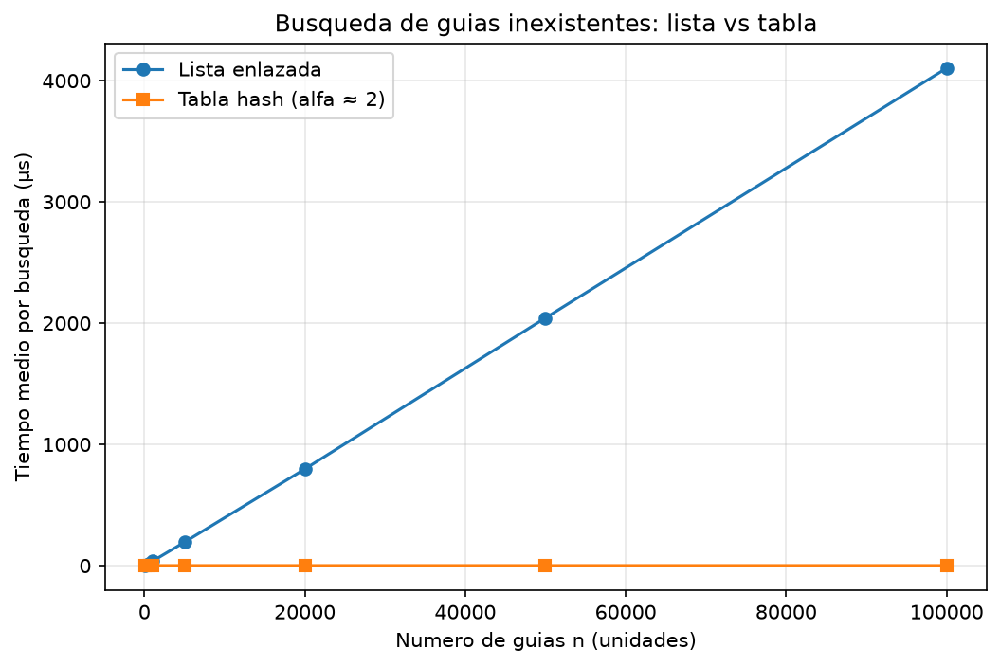
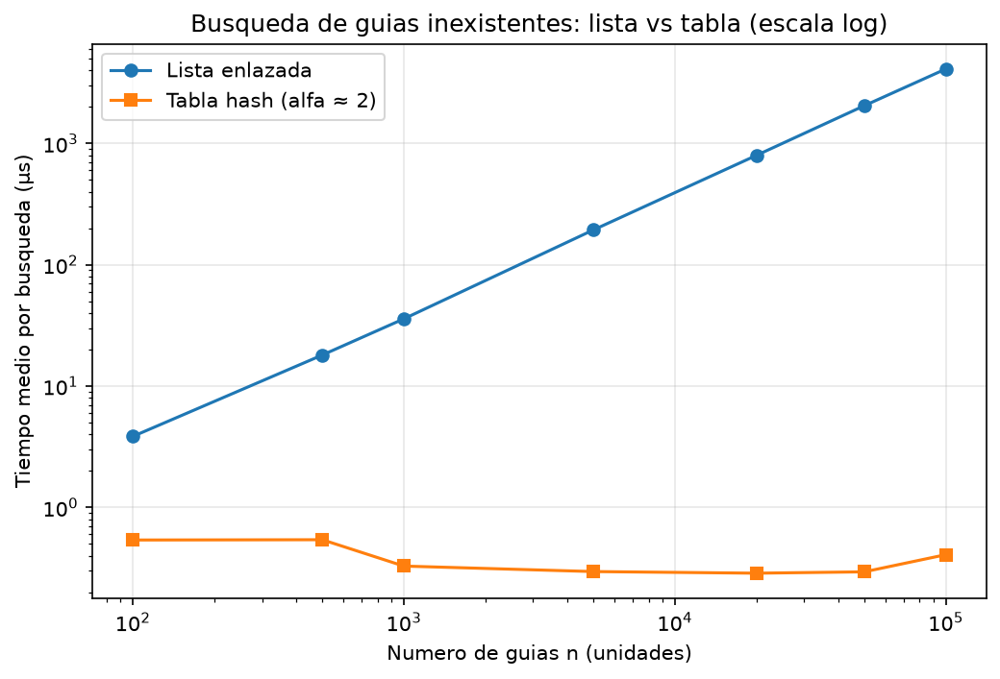
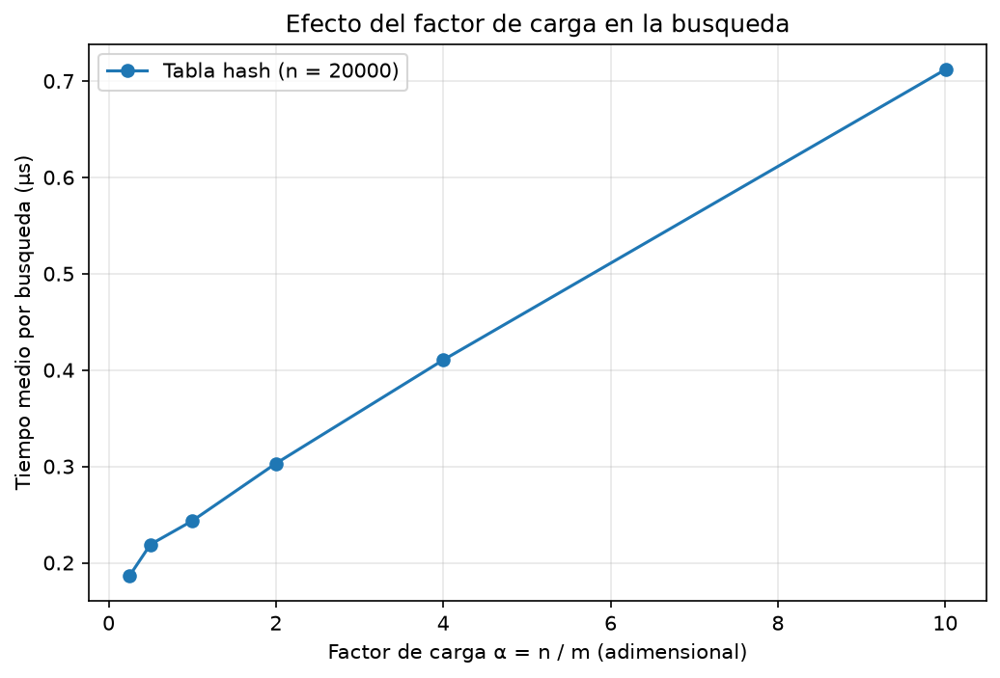

# Laboratorio Evaluativo 03: Estructuras de Datos

- **Estudiante:** Leonel Antonio Martínez Silgado
- **Curso:** Análisis de Algoritmos

---

## Instrucciones de Reproducción

1. Abra la terminal en la raíz del repositorio y active el entorno virtual:
   * Windows: `venv\Scripts\activate`
   * macOS / Linux: `source venv/bin/activate`
2. Instale las dependencias: `pip install -r laboratorios/lab3-estructuras-datos/requirements.txt`
3. Entre a la carpeta del laboratorio: `cd laboratorios/lab3-estructuras-datos`
4. Pruebas: `python pruebas.py` (imprime "Todas las pruebas pasaron.")
5. Medición y gráficas: `python medicion.py` (tarda cerca de un minuto; imprime las tablas y regenera los PNG en `graficas/`)

---

## Parte 1 — Implementación y Verificación

Código de esta parte:
- [estructuras.py](./estructuras.py)
- [pruebas.py](./pruebas.py)

**Casos verificados con `assert` en `pruebas.py`:**
* Búsqueda exitosa e infructuosa en la lista (incluida la lista vacía y la inserción al inicio) y en la tabla, con la serie de ejemplo del enunciado.
* Colisión forzada con m = 7: las guías 10, 24 y 17 caen en la casilla 3, se insertan, se recuperan, y la lista de esa casilla tiene longitud 3 mientras las otras seis están vacías.
* `factor_carga()` es exactamente 3 / 7 tras esas tres inserciones.
* 20 colecciones aleatorias (semilla fija, n entre 1 y 500, m entre 1 y n + 3): lista y tabla devuelven lo mismo para todas las guías existentes y para 100 guías inexistentes por colección.

---

## Parte 2 — Medición y Gráficas

Código de esta parte: [medicion.py](./medicion.py)

**Cómo se midió:**
* Se cronometraron solo las búsquedas con `time.perf_counter()`; la construcción de las estructuras y la generación de datos quedan fuera.
* En cada n, 200 búsquedas de guías inexistentes (función `generar_guias_inexistentes`, semilla 7). Las guías almacenadas se generan con semilla 42 y son las mismas para lista y tabla.
* Cada medición se repitió 15 veces y se reporta la menor media por búsqueda (descarta el ruido del sistema operativo). Se desactivó el recolector de basura durante el cronometraje.
* Experimento A: m es el primo más cercano a n / 2, por lo que α ≈ 2. Experimento B: n = 20 000 y m es el primo más cercano a n / α.
* Dentro de cada experimento se verifica que lista y tabla devuelven el mismo estado para 200 guías existentes.
* Los tiempos de A y B no son comparables en valor absoluto entre sí (el caso n = 20 000, α = 2 aparece en ambos con 0,287 µs y 0,303 µs); cada análisis usa solo valores de su propio experimento.

### Experimento A — Lista frente a tabla

Como la tabla casi no se distingue en la escala lineal, se agrega la misma información en escala logarítmica:

**Valores medidos** (guías inexistentes, tiempo medio por búsqueda):

| n | m | α | Lista (µs) | Tabla (µs) |
|---|---|---|-----------|-----------|
| 100 | 47 | 2,13 | 3,85 | 0,540 |
| 500 | 251 | 1,99 | 18,04 | 0,543 |
| 1 000 | 499 | 2,00 | 35,85 | 0,329 |
| 5 000 | 2 503 | 2,00 | 193,44 | 0,297 |
| 20 000 | 10 007 | 2,00 | 796,74 | 0,287 |
| 50 000 | 24 989 | 2,00 | 2 043,31 | 0,295 |
| 100 000 | 49 999 | 2,00 | 4 102,93 | 0,409 |

**Factor de crecimiento entre valores consecutivos de n** (tiempo siguiente / tiempo anterior):

| De n a n | Factor en n | Lista | Tabla |
|----------|-------------|-------|-------|
| 100 → 500 | ×5,00 | ×4,68 | ×1,01 |
| 500 → 1 000 | ×2,00 | ×1,99 | ×0,61 |
| 1 000 → 5 000 | ×5,00 | ×5,40 | ×0,90 |
| 5 000 → 20 000 | ×4,00 | ×4,12 | ×0,97 |
| 20 000 → 50 000 | ×2,50 | ×2,56 | ×1,03 |
| 50 000 → 100 000 | ×2,00 | ×2,01 | ×1,38 |

### Experimento B — Efecto del factor de carga (n = 20 000)

| m | α | Tabla (µs) | Factor respecto a la fila anterior |
|---|---|-----------|------------------------------------|
| 79 999 | 0,25 | 0,187 | — |
| 40 009 | 0,50 | 0,219 | ×1,17 |
| 19 997 | 1,00 | 0,244 | ×1,11 |
| 10 007 | 2,00 | 0,303 | ×1,24 |
| 4 999 | 4,00 | 0,411 | ×1,35 |
| 1 999 | 10,01 | 0,712 | ×1,73 |

---

## Parte 3 — Análisis

### 1. Costo teórico

En una búsqueda infructuosa (guía inexistente), la lista enlazada no puede detenerse anticipadamente, por lo que debe recorrer de principio a fin los $n$ nodos hasta encontrar None, arrojando un costo de $\Theta(n)$. Por su parte, la tabla hash calcula la casilla en tiempo constante $\Theta(1)$ y luego recorre la lista de esa casilla; definiendo el factor de carga como $\alpha = n / m$ (el largo promedio de cada lista), el costo medio esperado es $\Theta(1 + \alpha)$. Este resultado se sostiene bajo el supuesto de Hashing Uniforme Simple (SUHA), que exige que cada clave tenga la misma probabilidad de caer en cualquier casilla. Si ocurre el caso patológico en el que todas las guías colisionan en una sola casilla, esta acumulará los $n$ nodos y la tabla se degradará a una lista enlazada de costo $\Theta(n)$.

### 2. Lo medido contra lo esperado

Tomando dos valores consecutivos de la primera gráfica para la lista enlazada, de $n_1 = 5.000$ a $n_2 = 20.000$ ($n$ se multiplicó por 4), el tiempo medio pasó de $193,44$ µs a $796,74$ µs, un incremento de $\times 4,12$ que coincide con el comportamiento lineal $\Theta(n)$. Para la tabla hash en ese mismo rango, el tiempo pasó de $0,297$ µs a $0,287$ µs ($\times 0,97$), confirmando el tiempo constante $\Theta(1)$. En la segunda gráfica con $n = 20.000$ fijo, el tiempo medio fue de $0,187$ µs en $\alpha = 0,25$ y de $0,712$ µs en $\alpha = 10$; esta curva responde a la función $1 + \alpha$, donde $1$ representa el costo fijo del cálculo hash y la pendiente $\alpha$ refleja el costo proporcional de recorrer los nodos encadenados.

### 3. Colisiones

Una colisión ocurre cuando dos claves distintas generan el mismo índice hash ($h(k_1) = h(k_2)$). Ocurren inevitablemente porque el espacio de claves posibles ($9 \times 10^9$ guías) supera por mucho las casillas disponibles, cumpliendo el Principio del Casillero aun si $m > n$. Por ejemplo, con $m = 7$ y $h(k) = k \bmod 7$, las guías $10$, $24$ y $17$ colisionan en la casilla 3 ($10 \bmod 7 = 3$, $24 \bmod 7 = 3$, $17 \bmod 7 = 3$). El encadenamiento inserta las tres guías en la lista de esa casilla; su ventaja es que soporta $\alpha > 1$ sin colapsar, a costo de usar más memoria en punteros y sufrir fallos de caché. Por su parte, el direccionamiento abierto guarda todo directamente en la tabla: la guía 10 ocupa la casilla 3, mientras que la 24 y la 17 aplican una secuencia de sondeo para buscar y ocupar las siguientes casillas libres disponibles; su ventaja es la localidad de caché y menor uso de memoria, pero exige estrictamente $\alpha < 1$ y padece de agrupamiento.

### 4. Tabla hash o árbol de búsqueda

La tabla hash destruye el orden de las claves al dispersarlas, por lo que para consultar un rango ("guías entre $X$ e $Y$") obligaría a revisar las $m$ casillas y todos los nodos ($\Theta(m + n)$). Un Árbol de Búsqueda Binario (ABB) permite hacer un recorrido en orden para ubicar el primer valor $\ge X$ y avanzar secuencialmente reportando $k$ guías con costo $\Theta(h + k)$, donde $h$ es la altura del árbol. Sin embargo, si las $400.000$ guías se insertan una a una ya ordenadas en un ABB sin balancear, el árbol se degenera totalmente en una cadena lineal de altura $h = 399.999$, requiriendo unas $400.000$ comparaciones en el peor caso ($\Theta(n)$). En contraste, si el árbol estuviera equilibrado, su altura sería $\log_2(400.000) \approx 19$ niveles ($2^{18} = 262.144$ y $2^{19} = 524.288$), requiriendo máximo 19 comparaciones.

### 5. Concepto para la jefa de operaciones

Se recomienda una solución híbrida: una tabla hash (con $\alpha \le 1$) para consultas puntuales del call center y un árbol binario equilibrado (como AVL) para monitoreo por rangos. Para $5.000.000$ de envíos, estimamos la búsqueda infructuosa en la lista tomando el dato empírico de $n = 100.000$ ($4.102,93$ µs); escalando por 50 ($5.000.000 / 100.000$) y aplicando la linealidad demostrada al duplicar de $50.000$ a $100.000$ ($\times 2,01$), la lista tardará $4.102,93 \text{ µs} \times 50 \approx 205.146,5 \text{ µs} \approx 205 \text{ ms}$. Para la tabla hash, operando con la recomendación de $\alpha \le 1$, el tiempo estimado se mantendrá menor a $0,25$ µs (basado en los valores de $0,187$ a $0,244$ µs medidos en el Experimento B, mejorando el rango de $0,29$ a $0,41$ µs que se obtuvo con $\alpha \approx 2$). Cabe aclarar que esto es una estimación teórica proyectada y no una medición directa; en la tabla hash a $5.000.000$ de elementos existe incertidumbre por posibles fallos de caché de la CPU al aumentar el tamaño total de la memoria utilizada, lo cual se intuye en la ligera subida de $50.000$ a $100.000$ ($\times 1,38$).
